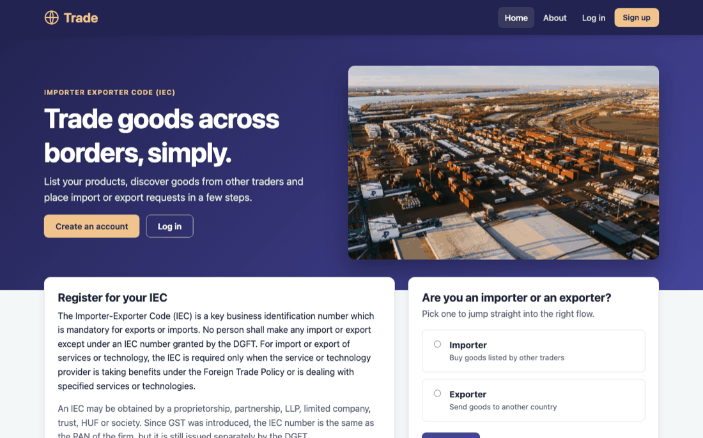
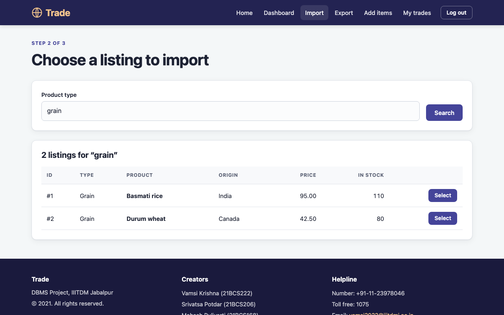
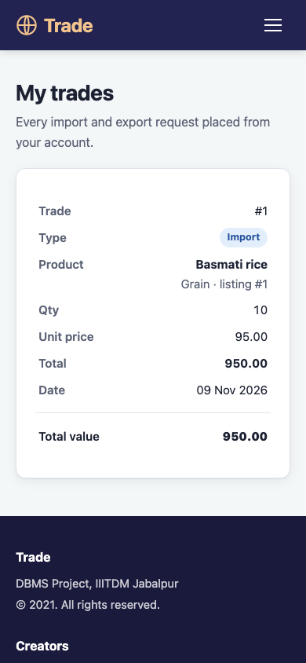

# Trade

A PHP + MySQL import/export marketplace: registered users list goods for trade and place import or export requests for listed items.


## Overview

Trade is a server-rendered PHP website built around Importer Exporter Code (IEC) style trading. After signing up and logging in, a user lands on a trade dashboard. From there they can import an item (search the available listings by product type and request a quantity), export an item (search by product type and name and submit export details), or add their own items to the catalogue. Each trade lowers the available quantity and is recorded in an import or export table and in a combined `total_table`.

## Screenshots

| Landing page | Import search | My trades (mobile) |
| --- | --- | --- |
|  |  |  |

## Features

- Landing page with IEC information, links to the DGFT portal, and an importer/exporter chooser that takes you straight into the right flow.
- Sign up (name, age, sex, phone, email, password, city, pincode, country) and log in with your email. Passwords are hashed with `password_hash()`.
- A dashboard with live counts (listings in stock, your listings, your trades), quick actions and static reference charts.
- **Add items**: list a product with its type, name, origin country, quantity and unit price, and see your own listings.
- **Import flow** (`7_import.php` → `8_import.php` → `9_import.php` → `11_import.php`): search by product type, pick a listing, confirm your contact and destination details (pre-filled from your profile), and submit.
- **Export flow** (`12_export.php` → `15_export.php` → `13_export.php` → `14_export.php`): search by type and (optionally) name, pick a listing, enter your details, and submit.
- Each request reduces the listing's stock atomically (it can never go below zero) and is recorded in `import_data` / `export_data` and in `total_table`.
- **My trades** (`16_invoice.php`): your import and export history with quantities, totals and dates.
- Responsive layout with a mobile menu, clear form labels, inline validation messages, and empty/error states.

## Tech stack

- PHP 8.1+ (procedural, PDO with prepared statements)
- MySQL 5.7+ / MariaDB 10.3+
- HTML and a single hand-written stylesheet (`2_style.css`), no frameworks or external assets

## Project structure

```
Trade/
├── index.php            # redirects to the landing page
├── 1_main_page.php      # public landing page
├── 2_style.css          # all styles
├── 4_login.php          # log in (email + password)
├── 5_signUp.php         # registration
├── 6_trade.php          # dashboard after login
├── 7_import.php … 11_import.php   # import flow
├── 12_export.php … 15_export.php  # export flow
├── 10_add_items.php     # add a listing / your listings
├── 11_logOut.php        # log out (POST)
├── 16_invoice.php       # my trades
├── includes/
│   ├── bootstrap.php    # config, session, PDO connection, CSRF and helpers
│   ├── trade.php        # shared import/export logic
│   ├── header.php
│   └── footer.php
├── schema.sql           # database schema
├── seed.sql             # optional demo data
├── .env.example
└── *.png / *.jpg        # page images and chart graphics
```

## Getting started

### Prerequisites

- PHP 8.1 or later with the `pdo_mysql` extension
- MySQL or MariaDB. A bundle such as XAMPP, WAMP or MAMP works well.

### 1. Get the code

Clone the repo into your web server's document root, for example `htdocs/` in XAMPP:

```bash
git clone https://github.com/VamsiKrishnaThota03/import-export-portal.git
```

### 2. Create the database

```bash
mysql -u root -p < schema.sql          # creates the `project` database and tables
mysql -u root -p project < seed.sql    # optional: demo data
```

You can also paste the files into phpMyAdmin's SQL tab. The seed adds a demo account, `demo@example.com` / `demo12345`, with a few listings. It is for local use only.

### 3. Configure the connection

Copy `.env.example` to `.env` and adjust it, or set the same variables in your server environment (real environment variables win over `.env`). The defaults match a stock XAMPP/MAMP install.

| Variable    | Description                                                    | Default     |
| ----------- | -------------------------------------------------------------- | ----------- |
| `DB_HOST`   | MySQL host                                                     | `localhost` |
| `DB_PORT`   | MySQL port                                                     | `3306`      |
| `DB_NAME`   | Database name                                                  | `project`   |
| `DB_USER`   | MySQL user                                                     | `root`      |
| `DB_PASS`   | MySQL password                                                 | empty       |
| `DB_DSN`    | Optional full PDO DSN; overrides host, port and name           | unset       |
| `APP_DEBUG` | `true` shows PHP errors in the browser (local development only) | `false`     |

### 4. Run

Start Apache and MySQL, then open `http://localhost/Trade/`.

Without Apache you can use PHP's built-in server from the project folder:

```bash
php -S localhost:8000
```

and open `http://localhost:8000/`.

## Security

- All queries use PDO prepared statements.
- Passwords are stored with `password_hash()` and checked with `password_verify()`. Accounts created by older versions with plain-text passwords still work: the password is re-hashed on the next successful login.
- Every form that changes data carries a CSRF token, and every trading page requires a logged-in session. The session ID is regenerated on login and logout is a POST request.
- Output is HTML-escaped, and listing details (name, type, price) are always re-read from the database rather than trusted from the form.
- `.htaccess` blocks direct access to `includes/`, `.env` and the `.sql` files on Apache. If you use another web server, block those paths there.

## Upgrading an existing database

Older versions had no schema file, so existing databases may differ. The code now expects:

- `available.pid` to be `AUTO_INCREMENT` and `price` to be numeric
- `qty` and `created_at` columns on `import_data`, `export_data` and `total_table`, plus an `id` primary key on each

The simplest path is to export your data, run `schema.sql` on a fresh database, and re-import it.

## Known limitations

- There is no password reset. The old, unfinished forgot-password pages were removed.
- The dashboard charts are static images, not live market data.
- Export requests reduce the listing's stock in the same way imports do. There is no separate approval or shipping workflow.
- Listings cannot be edited or deleted from the UI.
